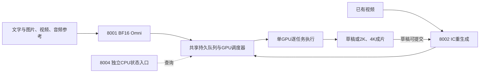

# MiniMax H3／FastH3 系列本机部署经验

整理日期：2026-11-24。适用机器：Ubuntu 26.04.1、单张 RTX 6000D，SM120、156 SM、85,651 MiB 显存（约83.6 GiB）。本文总结本项目实际部署、失败排查、成片与性能测试，不代表其它显卡或上游最新版本的通用结论。

**正式方案是 FastVideo BF16 Omni 负责参考生成，优化后的 Open-H3 IC 负责本地2K／4K重生成，两个 HTTP 入口通过共享队列串行使用显卡。** 旧 NVFP4、完整 H3 教师和实验框架保留配置，不自动切换上线。2026-11-24只读核对时，两个入口均可接单、调度器空闲、无运行任务、显卡占用为0 MiB，相关服务全部禁用开机自启。本次整理没有加载模型、重跑测试或改变配置。

[跨机器调用](video-http-api.md) · [启停与共享队列](video-http-queue.md) · [管理／维护接口](video-queue-management.md) · [调研总索引](video-framework-research-index-2026-11-17.md) · [本次核对证据](../deployment/minimax-h3/deployment-experience-evidence-20261124.json)

2026-11-25补充：[Qwen／视频统一HTTP、GPU队列与费用记录预研](unified-model-gateway-queue-feasibility-2026-11-25.md)已验证现有Bifrost的聊天／视频协议和终态计价。统一入口、一小时模型保护与注册表仍为待实施设计；本文下面的正式部署状态没有因此改变。

## 1. 先分清模型、任务与生成阶段

| 对象 | 本机用途与输入 | 关键计算配置 | 部署结论 |
| --- | --- | --- | --- |
| FastH3 V2 NVFP4 Consumer | 已验证文字生成视频及同步音频 | V2蒸馏检查点，8次前向，VSA 0.8 | 历史部署；不能把通用接口接受图片当作本机已验证 Ref2VA |
| FastH3 Omni NVFP4 QAD | 文字＋图片／视频，及可选音频参考生成 | 专门量化训练的学生检查点，8次前向，VSA 0.9，36L质量解码器 | 已实际完成参考生成和15秒案例；现为历史方案 |
| FastH3 Omni BF16 | 同类多模态参考生成，当前名称 `fasth3-omni-bf16` | BF16学生检查点，8次前向，VSA 0.9，原版36L VAE | 正式8001服务；最大尺寸已验收5秒，15秒曾OOM |
| 完整 MiniMax H3-Base Ref2VA BF16 | 原始参考生成教师；曾接入完整 H3→2K 串联任务 | 50步、CFG 1、密集注意力、完整底座 | 历史服务已停止，相关性能实验维持暂停；不与8步学生混称 |
| Open-H3-Regenerate-2K-IC | 已有视频＋可选文字，重生成为2K／4K | 完整BF16 Ref2VA底座＋IC LoRA／HyperFlow／Sharp／潜空间放大器，默认 `up3`，36L FP32 VAE | 正式8002服务；名称仍为 `open-h3-2k`，以 `size` 选择4K |

`Ref2VA` 是参考素材生成音视频的任务／管线概念，不是另一个需要单独选择的检查点。`Omni`／`OmniRef` 必须结合实际发布仓库、权重版本和管线识别；只改请求里的 `task` 不能把 V2 变成参考模型。首帧／尾帧约束与一般参考图也不是同一接口合同，不能因为存在图片字段就承诺固定首帧。

“完整 H3 没有作为草稿服务运行”与“IC 不使用完整底座”是两件事：IC 内部依然加载完整 BF16 H3 底座，但执行专用重生成采样，不先运行50步教师草稿生成。因此 **Omni、其它模型甚至已有成片都能成为 IC 输入，不要求先经过完整教师**。

本地 IC 是 **NVlabs/Sana 的开放替代路线**，不是 MiniMax 官方托管 Context-IR／H3-Regenerate-2K 模块。下载公开 Base 不等于得到官方完整2K系统。本项目不调用官方云端，也未复现其闭源 Context-IR。

## 2. 当前架构：HTTP常驻，GPU按任务调度



两个入口、网页与状态服务可以同时在线；它们不是两套同时计算的GPU模型。API／调度器不加载权重，实际模型在隔离 worker 内按阶段加载与释放。Omni连续任务可复用后端进程，仍不能让编码器、DiT、VAE全部永久驻留；空闲约120秒后释放后台模型。关闭浏览器或网页不等于停止已入队任务。

队列使用 SQLite 持久化上传记录、任务、依赖和事件。客户端可以先统一生成草稿，再统一提交重生成；也可通过 `input_video.job_id` 提前建立依赖。素材应在客户端上传成 `file_id`，不能把另一台机器的路径当作服务器文件。当前两个端口共享文件记录；历史独立版“跨端口文件ID不能共用”已不适用于现部署。

显式优先级／插队序号先于模型亲和；同组内按同模型复用、最多连续3个任务与另一模型等待30分钟的公平规则选择。切换只发生在任务或已派发小批次边界，不能承诺等待30分钟后必定完成。4K一次一任务；2K可按相同尺寸、seed、sampler组织最多两个任务、每次最多两个窗口。每模型最多32个 queued／in_progress，满时429；长队列消耗磁盘和等待时间，不预先为每条任务加载模型。

## 3. 可恢复部署靠版本与哈希，不能只留环境名

FastVideo 基线固定为 `a0e6cf1f5086c9af735d73e6c0b80dbc1d5817b3`，本机补丁另行保存；基础环境为 Python 3.12.16、PyTorch 2.12.0+cu130，IC入口使用 Diffusers 0.42.0／Accelerate 1.0.1。CUDA编译工具使用本地13.2工具链，不能把编译器版本与 PyTorch 自带运行库版本混为一谈。

| 权重 | 固定发布版本 | 复用与恢复注意事项 |
| --- | --- | --- |
| Omni NVFP4 QAD | `FastVideo/FastH3-Omni-NVFP4-QAD@f01e6a23ac6066aa9eb622cf94b6259442e70ec2` | Ref2VA专用 AdaLN 表与完整组件；[历史配置与修复](fasth3-omni.md) |
| Omni BF16学生 | `FastVideo/FastVideo-FastH3-Omni-8-Step-V1@53e0d26a1691aa473b6262d8196a8feb2c297df0` | 专用DiT约65.33 GiB；共享组件按 `MiniMaxAI/MiniMax-H3@9bfb6693f2cf6de171db46d1aa586f67d773a1da` 组合，不把NVFP4文件改名充当BF16 |
| 完整H3 Ref2VA | `MiniMaxAI/MiniMax-H3@0919fb684102ef115126612f3fbb84d1027e7317` | 约134.16 GiB；[下载与校验](../deployment/minimax-h3/weight-verification.json) |
| 本地IC包 | `Efficient-Large-Model/Open-H3-Regenerate-2K-IC@54a7104b204fb46486cf85c2f600942118186d57` | 与Base匹配的文件按发布者SHA复用；[校验](../deployment/minimax-h3/open-2k-weight-verification.json) |

下载经验：固定 revision，核对文件大小、LFS SHA-256及分片索引；传输镜像不是哈希来源。Base共63文件、IC包共94文件，只有发布者哈希匹配的大文件才硬链接共享。IC额外组件约18.19 GiB，包括约7.73 GiB FP32 IC LoRA，以及 HyperFlow、Sharp、潜空间放大器和备用24L VAE。**共享文件不可原地合并LoRA或覆盖写回**，否则会污染其它部署。

下载最多两条通道、每条一个文件，6 GiB隔离，关闭Xet高性能缓冲；完成事件只通知，不将“已下载”自动升级为“允许启动”。运行设置离线读取，缺文件应明确失败，不能在推理时悄悄补下载。IC独立 `.venv-h3-2k` 只读复用已有依赖，不升级线上包；候选框架另建环境。搜索模块时应覆盖真实虚拟环境，不能把搜索忽略 `.venv` 误判为实现不存在。

本机 SM120 曾遇到预编译包缺少稀疏FP4接口的问题，需要按本机架构编译 `fastvideo-kernel` 并做数值检查。GPU架构支持、包能安装、模型能导入、真实成片是四种证据，不可相互替代。[源码、配置与普通子目录恢复](deployment-git.md)

主仓库权威路径是 `local-model-operations/deployments/video-generation/`，是普通子目录，不是Git子模块或上游FastVideo仓库。Git只保存配置、脚本、补丁和可审阅证据，不包含权重、虚拟环境、用户素材、成片或凭据；`git clone` 本身不能恢复可推理机器。迁移时还需调整启动脚本和unit中的本机绝对路径。

## 4. 几个影响效果和兼容性的关键坑

### 采样阶梯与 AdaLN 必须匹配

V2配置的9个采样点对应8次模型前向；Omni Ref2VA配置按其自身8次PDD计算约定；完整教师是另一套50步路线。不能把8／9／50当成同一模型可以随意切换的质量档，也不能把负面提示词、CFG等通用字段视作当前模型均支持。

曾出现 `No precomputed AdaLN modulation ... fixed ladder`，即使显式 Ref2VA、8步仍失败。实际发现的一类原因是缓存按**完整 timestep 集合**查找：图片参考缺少音频参考的 timestep，表里已有所需行，集合键却不相同。修复为在相同embedding维度、dtype下精确匹配已有行的子集／顺序，9项回归与400次真实投影检查通过，随后API和网页都生成成功。

这不意味着所有报错都能用子集回退解决：先核对检查点、表来源、任务和采样阶梯，未知 timestep 仍要拒绝；不能四舍五入、插值或拿V2表冒充Omni表。BF16用自己的权重和精确 timestep 缓存，不能复用NVFP4表。[故障与修复证据](../deployment/fastvideo/adaln-verification-20261116.json)、[补丁](../deployment/fastvideo/adaln-reference-subsets.patch)

### 36层不等于所有路径计算精度相同

已验证的 Omni质量部署使用36L，不是8L快速解码器。NVFP4包同时带36L质量版与8L快速版，文件存在不代表实际启用。BF16 Omni用原版36L，FP32权重存储并沿用FastVideo发布版的FP16解码混合精度；IC则使用原版36L FP32 tiled／流式解码。IC包的24L快速VAE只是备用，未替换正式解码器。

减少解码层数、改精度或改VSA稀疏率都需要重新评估画质。不能用“同为36L”证明跨框架逐像素相同，也不能把NVFP4 QAD与BF16的速度差全部归因于量化：编码器、放置、预热和解码路径均需分列。

### 参数接受范围不等于显存验收范围

Omni原生画幅面积上限为1,032,192像素，常用1344×768／768×1344；24 FPS，5～15秒请求按 `17n+5` 对齐。例如5秒请求通常124帧、约5.167秒，15秒为362帧、约15.083秒。帧数比取整后的“秒数”更适合作为成本和路径判断依据。

NVFP4曾完成最大竖屏15秒参考生成；BF16最大尺寸已有5秒成片，15秒1344×768曾OOM。用户当时要求不采用会降速的分层卸载，因此不能为了通过任务自动改卸载、精度、步数、尺寸或其它镜头时长。**14秒IC整段4K成功，不是BF16 Omni 14／15秒参考生成已验收的证据。**

参考生成会重新合成画面，不保证逐帧复制动作或像素级换人。白框出框、固定原配乐、裁秒、GIF体积控制属于独立后处理；它们不是模型原生分辨率、时长或参考遵循能力的证明。[历史人物替换流程](fasth3-omni.md)

## 5. 2K／4K长片：以124帧为边界，不能写成5秒

本服务“2K”为2560×1440或1440×2560，4K为3840×2160。IC没有单独的参考图片入口；人物、动作等额外参考先交Omni生成到草稿，IC接收草稿和可选描述。输入音轨存在时保留内容并重新编码AAC，不重新生成配音。`up3`／`up4`／`hf8`分别对应3／4／8步采样配方，不能仅凭步数宣布画质排名；正式默认及本文长片样本使用 `up3`。

原IC脚本一次只读取124帧。早期先做重叠窗口：每窗124帧，15秒360帧规划4窗，按原始帧号保留各窗负责区间，保证不漏帧、不重复帧；这能通过时间轴软件测试，但独立扩散窗口仍可能在亮度、纹理、人物细节上产生接缝。

当前严格按**归一化到24 FPS后的帧数**分流：

| 输出路径 | 时长处理 |
| --- | --- |
| 4K，≤124帧 | 原单窗口路线，124帧本身也走旧路线 |
| 4K，>124帧 | 完整时间轴一次IC去噪，不独立分段，不静默回退窗口拼接 |
| 2K长片 | 保留原重叠窗口路径；不能把4K改造外推为2K已同步改造 |

124／24≈5.166667秒，**不是120帧或5秒阈值**。整段路线补齐模型时间网格后再裁回源帧数：10秒240帧补至243，14秒336帧补至345。4K内部计算3840×2176，最终上下各裁8行输出3840×2160，不把普通插值导出称为原生4K。

为了装进单卡，投影和query按16384 tokens分批、FFN按2048分块；**每批query仍读取全片K/V**，不是独立时间窗口。保留完整去噪步检查点和latent，允许同一有效任务续解码。36L输出流式处理，避免一次持有所有像素帧。这个实现证明了完整时间轴可计算，不意味着已证明与无法在本机整体加载的原执行方式逐位相同。

代价是长序列密集注意力成本随token数近似平方增长；分批query主要解决峰值内存，不减少所有query与所有K/V的交互。14秒比5秒慢很多不能只按时长线性推算。S48的14秒完整4K已通过LAN下载、SHA、几何、全片解码和抽帧检查，对端人眼审核仍待反馈；10秒S20也已完成，本次另核对本地最终文件SHA和媒体头。**15秒整段模型成片不能仅由14秒成功或API范围来宣布验收。**

[4K接口与路线](open-h3-4k-http.md) · [接缝调查](open-h3-seam-solutions-2026-11-20.md) · [整段验收](h3-full-sequence-validation-and-dense-benchmark-2026-11-21.md)

## 6. 本卡实际速度：计时范围必须一起保留

| 路线／案例 | 输出 | 实际耗时 | 口径与限制 |
| --- | --- | ---: | --- |
| V2 NVFP4 | 1344×768，124帧 | 63.1秒 | 历史预热单次，含保存；不是参考生成 |
| V2 NVFP4 | 1344×768，362帧 | 280.5秒 | 同上；首次编译另计 |
| Omni NVFP4 QAD | 1344×768，124帧 | 350.32秒 | 同素材对照，请求前组件已常驻 |
| Omni BF16 | 1344×768，124帧 | 759.21秒 | 包含分阶段加载；与NVFP4总耗时比不能当成纯算术倍率 |
| 当前优化IC控制器 | 2560×1440，124帧 | 1498.407秒 | 完整2K控制器对照样本；不含前级Omni和排队 |
| 当前4K单窗口，7条120帧样本 | 3840×2160，5秒 | 76分26秒～77分20秒；中位76分48秒 | 队列dispatch到completed，含worker准备和封装，排除此前排队；不是优化前后对照 |
| S20整段IC | 3840×2160，240帧／10秒 | 4小时16分12秒 | 同上，2026-11-21 13:38:53完成；本次核对本地SHA和媒体头，未重做全片解码／LAN下载／人眼审核 |
| S48整段IC | 3840×2160，336帧／14秒 | 8小时7分28秒 | 原验收worker总耗时，排队和前级Omni另计 |

V2原测来自本机 `outputs/benchmark-5s.json`／`benchmark-15s.json`，已将不含提示词和媒体的计时摘录加入[本次证据](../deployment/minimax-h3/deployment-experience-evidence-20261124.json)；Omni分阶段记录见[BF16对照](omni-bf16-benchmark.md)；2K见[框架实测](video-framework-benchmark-2026-11-17.md)；新增4K队列样本也在本次证据中。不同输入、帧数、参考模态、缓存状态和框架版本的样本不能混成公平排名。

S48采样占实际worker墙钟约95.69%，36L解码与无损输出3.38%，其余约0.93%。即使把解码假想为免费，也只省约16.5分钟；把外围加载、编码全部消除也无法将八小时变成几十分钟。这里95.69%是**采样**占比，不能偷换成profiler测得的纯注意力占比。

估时使用最近实际完成的层数／采样步速率，加解码封装余量。客户端 `created_at` 包含排队，不能当推理起点；35%等阶段值可能长时间不变，不能按百分比线性外推。整段任务已提供第几步／第几层，应结合日志更新时间、worker存活和GPU工作状态判断是否停滞。

## 7. 优化与框架迁移：采用什么，拒绝什么

**已采用的同结果搬运优化**：312个LoRA的实际BF16转换值缓存；保持A后B的未合并运算；保留不可变CPU权重，省掉无意义D2H；FFN以原2048-token GEMM形状写入预分配输出。节省约3.87 GiB主存存储，真实4K首层约18.59亿个BF16值逐元素一致；代表性4K／2K单层耗时约降2.0%／6.6%。这不是完整视频相同比例的加速成绩。[完整限制与证据](open-h3-exact-performance.md)

| 候选 | 实测结论 | 去留 |
| --- | --- | --- |
| Accelerate／Diffusers替代IC搬运 | 同一完整2K对照1498.407／1506.335／1562.786秒，最终latent和全部RGB像素一致；当前版／Accelerate／Diffusers依次列出 | 当前实现保留；该数据不等于比较所有流式offload方案 |
| SGLang Diffusion／UniServe | 都生成过完整Omni成片，部分请求有提速迹象；依赖、放置、算子、缓存、构图不同，公平预热量产比较未完成且已取消 | 不宣布量产输赢，不替换线上，不自动恢复取消测试 |
| 两个Strata | Niko1221/Strata、ro99/strata均实际尝试现有H3准入，未得到可运行H3视频入口 | 不用LLM tokens/s冒充视频性能 |
| cuDNN BF16 dense | 大形状比现用约快0.4%～0.45%，有数值差异 | 基本打平，不切换 |
| FlashInfer FA2 BF16 dense | 约慢3.6%；949232-KV HND形状末头末尾哨兵失败、大误差 | 该版本／布局候选淘汰，不泛化为所有FlashInfer都错误 |
| 新FROST SM120 BF16 dense | 已独立构建并修正AOT主机引擎选择衔接，内核源码未改；5秒／14秒代表调用1137／3107 ms，现用1134／3102 ms；末尾K/V通过、有小幅数值差异 | 无有效提速，不采用；不能称已证明无损 |
| 仅SDPA CUDA Graph | 两种代表形状与现用逐位一致，速度基本打平 | 不推进整模型图捕获；现有卸载还会更换指针 |
| 双缓冲预取／直出MP4 | 独立256 MiB H2D和16帧4K编码探针已做；没有完整模型搬运等待或输出瓶颈收益证据 | 未上线全面重构；通用整模型双份pinned可能超80 GiB限制 |

本项目“同结果”要求逐元素完全一致。相同BF16、相同公式、高余弦相似度、同样层数都不能自动满足；浮点归约／融合会改变舍入。数值不同也不能直接证明画质变差，完整任务质量要另看人物、动作、构图、细节、时间稳定性与音画同步。没有明显收益时，不为候选再占用数小时队列。

冷启动、编译、加载单列；量产比较需要预热、相同缓存口径、相同参考预处理、输出合同和多条真实请求。FP4／稀疏内核、BF16密集内核分别对应不同模型路径，不能跨表混用。已有PDD头融合，换框架不是“从完全未融合到已融合”的单一差异。

[框架对比](video-framework-benchmark-2026-11-17.md) · [PDD与注意力解释](h3-pdd-attention-implementation-2026-11-17.md) · [cuDNN／FlashInfer短测](h3-full-sequence-validation-and-dense-benchmark-2026-11-21.md) · [FROST／图捕获短测](h3-engineering-optimization-tests-2026-11-21.md)

## 8. 内存故障与恢复：失败任务不复活

推理unit主机内存硬限80 GiB，`llmlab.slice`聚合88 GiB、swap最多1 GiB，保留独立内存看护。重负载必须经 `run_isolated.py`，并先 `resource_guard.require_isolation()`；编译jobs最多2，启动要求主机可用内存至少28 GiB。不能为了避免OOM移除限制或挤占会话宿主。

BF16 Omni历史5秒测试显存实占采样峰值约79.6 GiB，主机内存峰值79 GiB，已接近单卡和unit预算；最终阶段的API显存指标不能当整任务峰值。4K还要预算目标与参考token、注意力workspace和VAE激活，不是权重能放下就一定能生成。单卡同时跑两条完整4K没有已验收的端到端吞吐收益，当前不启用。

早期一次OOM直接进入长期 `paused_after_memory_failure`，会让后续可运行任务也一直等人工。当前策略：失败ID保持failed → 清理worker → 检查主机余量、GPU无计算进程且空闲显存≥95% → 清理后冷却60秒 → 恢复后续任务；连续两次OOM且中间无成功任务才人工熔断。资源不足或探测失败继续等待，不自动改请求。

管理恢复为 `POST /v1/queue/resume`，8001／8002同效。202只表示请求已接受，仍需等 `recovery.paused=false`；不会重试失败ID、跳过资源检查，也不会解除独立维护。完整参数与返回码见[管理恢复说明](video-http-api.md#oom-自动恢复与管理恢复接口)。

## 9. 当前入口、启停与跨机器调用速查

| 用途 | 当前入口 |
| --- | --- |
| 参考生成 | `http://192.168.1.11:8001/v1`，`fasth3-omni-bf16` |
| 本地2K／4K重生成 | `http://192.168.1.11:8002/v1`，`open-h3-2k` |
| 网页 | `http://192.168.1.11:7860` |
| 独立服务状态 | `http://192.168.1.11:8004/v1/service/status` |

局域网接口当前无API Key。`/health`只表示HTTP存活；独立状态区分 `available`／`busy`／`draining`／`upgrading`／`degraded`／`unavailable`，结合 `ready`、`accepting_jobs`、运行任务和心跳判断。维护拒绝新生成503／`Retry-After: 30`，查询、下载、取消和管理仍可访问。收到任务202后保存ID并轮询，客户端断线不取消任务，不因排队重复提交。

服务器按需启动，不执行 `enable`：

```bash
systemctl --user start video-gpu-scheduler.service fasth3-omni-bf16.service \
  h3-2k-refiner-http.service fasth3-omni-bf16-web.service video-service-status.service

curl --noproxy '*' --fail-with-body -sS http://192.168.1.11:8004/v1/service/status
curl --noproxy '*' --fail-with-body -sS http://192.168.1.11:8002/v1/queue
```

要保留在途成片，先 `POST /v1/service/maintenance` 设置 `enabled=true`，等当前任务完成、`running_jobs`为空、状态变为 `upgrading` 再维护。停止显卡调度但保留查询和下载：

```bash
systemctl --user stop video-gpu-scheduler.service

# 全部停止；仅停止HTTP前端不会自动停止仍在运行的调度器。
systemctl --user stop fasth3-omni-bf16-web.service fasth3-omni-bf16.service \
  h3-2k-refiner-http.service video-gpu-scheduler.service video-service-status.service
```

直接停调度器会停止GPU worker；重新手动启动后按现有检查点规则恢复，不能把它当“不打断任务”的操作。维护完成后核对原模型、资源和接口，再 `enabled=false` 解除属于自己的维护，不能覆盖其它操作者的新维护或OOM熔断。所有相关unit始终禁用开机自启，Qwen、旧NVFP4、V2和完整教师不能被运维脚本顺带恢复。

调用机器使用[Python客户端](../tools/video_http_client.py)，终端名 `2k` 同样用于4K：

```bash
python3 video_http_client.py omni --image ./character.png --video ./motion.mp4 \
  --prompt '保持 <Picture 1> 的人物外观，参考 <Video 1> 的动作。' \
  --size 1344x768 --seconds 5 --wait --output ./draft.mp4

python3 video_http_client.py 2k --video ./draft.mp4 --size 3840x2160 \
  --sampler up3 --wait --output ./result-4k.mp4
```

文件上传用 `POST /v1/files`；参考生成用 `POST /v1/videos`；重生成用 `POST /v1/videos/regenerations`。重生成时长来自视频，不另外传 `seconds`。草稿依赖也可传 `input_video: {"job_id":"video_gen_..."}`。下载 `GET /v1/videos/{id}/content` 后核对 `result.sha256`。插队、取消、优先级和分页浏览使用[API 3.0管理入口](video-queue-management.md)，正常运维不直接改SQLite。

## 10. 经验的验收边界与后续使用

权重哈希通过只证明文件一致；HTTP在线只证明可访问；完整生成要继续检查实际尺寸／帧数／时长／音轨、下载长度与SHA、全片解码和人眼画面。软件时间轴覆盖、算子正确性、完整模型运行、全片像素一致和跨机器接收端审核分别记录，不能统一写成“已验收”。

本次新增证据只读核对服务、模型元数据、禁用自启和既有任务计时，并核对S20本地成片SHA／媒体头；没有补做15秒模型测试、整片质量对照或新GPU基准。S48已有的LAN与抽帧验收继续引用原记录，不替对端追认人眼审核。

历史文档保留当时的NVFP4名称、手动停模型、未持久化任务或重叠窗口方案，不能直接照抄为当前生产配置。后续部署优先从本文和当前HTTP／队列文档进入，再按需要查对应日期的原始测评；运行事实以实时接口、当前源码与最新验收记录交叉核对。
