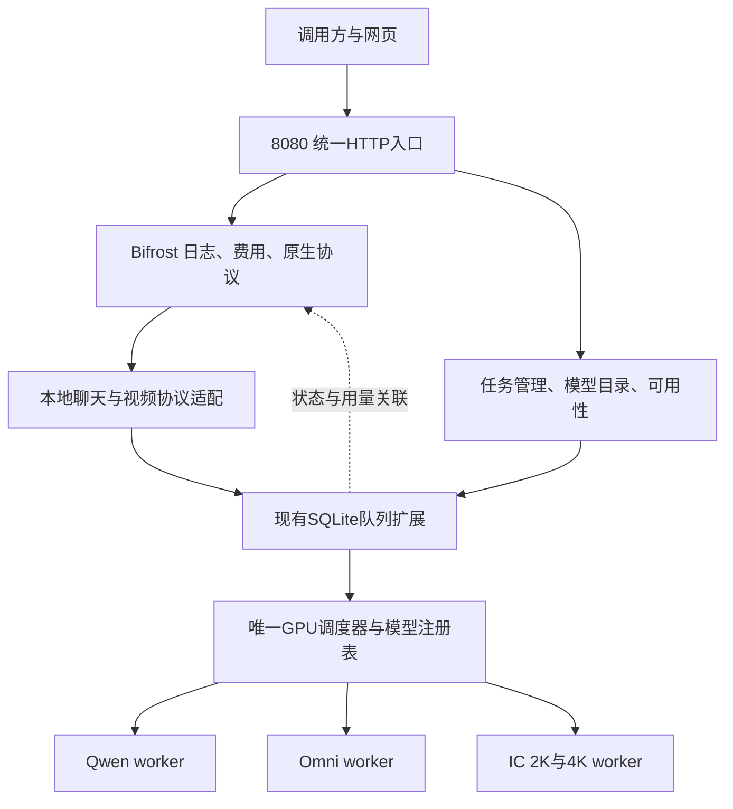

# 统一模型HTTP、GPU队列与费用记录：可行性预研

2026-11-25。用户希望聊天与视频统一入口、统一任务管理、同模型有任务时至少连续服务一小时，并预留新增模型能力；本轮最新要求先预研是否能够连同现有费用页整合。**结论：可行，推荐保留现有 Bifrost 作为统一HTTP／日志／计价入口，扩展现有持久GPU队列，并增加严格的本地模型协议适配。不是简单把所有地址反向代理到同一端口。**

本轮仅做只读现网检查、固定版本源码核查和隔离CPU协议实验；没有部署统一调度、修改线上路由、启动Qwen、运行真实模型或改生产费用。本文的接口、注册表和驻留规则是待实施设计，CPU实验通过不能称为全系统上线验收。

## 现状与必须先修的问题

| 项目 | 核查事实 |
| --- | --- |
| 视频 | 8001 BF16 Omni、8002 IC、8004独立状态已共享SQLite GPU队列；当前无运行／等待任务 |
| Qwen | 旧 `qwen38-coder.service` 停止，尚未加入视频调度器；原质量配置仍保留工具解析、32 sequences和MTP2 |
| 对外费用入口 | 8080 Caddy → 8081 Bifrost 2.3.2；已有聊天日志与自定义价格 |
| 路由冲突 | Bifrost的OpenAI provider指向8000，旧Caddy admission又指向8002；8002现在是IC，所以实际 `GET 8080/v1/models` 返回 `open-h3-2k`，而不是Qwen |
| GPU互斥 | 视频与旧Qwen还有各自的锁／启动路径，不能靠HTTP同时在线推断显卡统一受控 |

HTTP前端可同时在线；当前受限的是单卡显存和计算所有权。改造应为Qwen／Omni／IC分配独立的内部地址，只有统一调度器负责切换worker，不能让旧端口碰巧被哪个模型占用来决定请求发往何处。8002继续作为视频兼容入口，拟将Qwen内部端口调整到未占用的loopback端口或UDS，具体值在部署时核对。

## 已做的CPU验证：使用本机原二进制

执行程序为本机 `bifrost-http-v2.3.2`，SHA-256 `29ba0456fdad1e4eeaadec36ca6034dd6a77c335882aad91a5e20fff26673d15`；对应源码标签 `transports/v2.3.2`，提交 `a05ea20e68bf116a35e9f05b1a3d749624b3935e`。没有用最新dev的能力冒充已安装版本。

实验使用随机loopback端口、临时数据库／登录凭据、纯CPU假provider；4 GiB隔离，约17秒结束，峰值约338 MiB。没有读取或改写生产请求内容、生产凭据或生产数据库。

| 验证 | 实际结果 |
| --- | --- |
| 同一HTTP网关接聊天与视频 | 通过 |
| 原生异步聊天 | POST返回202，GET先pending／processing再completed，假模型仅收到一次请求 |
| 视频提交仍排队 | 提交日志没有结算金额 |
| 完成后按实际输出尺寸结算 | 假任务5秒／4K按测试单价结算0.10，失败假任务结算0 |
| provider回传金额 | 假provider回传0.123，最终结算采用0.123，而非0.10目录价 |
| 重复终态轮询 | 每视频只生成一条结算记录，没有重复计费 |
| 原费用日志API | 能读到实际视频模型行和 `video_retrieve` 记录，不只检查HTTP 200 |

**0.10／0.123均是fixture金额，不是给用户设定的单价，也不是实际支出。** 无真实视频、无真实LLM生成、无浏览器画面验收，尚未验证真实GPU换模、长时间等待、客户端断流恢复和整套统一任务状态。

[实验脚本](../deployments/video-generation/tools/probe_unified_gateway_feasibility.py)、[原始检查结果](../deployments/video-generation/deployment/video-queue/unified-gateway-feasibility-probe-20261125.json)。

## Bifrost 的 `openai` 视频适配与本地接口的差异

这里的 `openai` 是 **Bifrost 2.3.2 的 provider 类型**。它可以连接配置指定的本地 HTTP 后端。本文所说的视频转换器是 Bifrost 自己的 [`core/providers/openai/videos.go`](https://github.com/maximhq/bifrost/blob/a05ea20e68bf116a35e9f05b1a3d749624b3935e/core/providers/openai/videos.go)，负责将收到的视频请求按 OpenAI 兼容格式重组后发给下游。本次实验的下游是本机 loopback 模拟服务。

已实际复现：向本机Bifrost提交 `size=3840x2160`，假provider收到的却是 **720x1280**；同时只收到 `model`、`prompt`、`seconds`、`size`，没有 `image_reference`、`input_video`、`sampler`。即使设置已有extra-params透传头，默认视频multipart转换器仍没有完整传递这些字段。

固定版本源码与实验吻合。Bifrost 的这条适配路径采用 Sora 尺寸白名单，将白名单之外的画幅改成默认值。生成 multipart 请求时，它也没有完整带上本地接口的参考素材和采样参数。接入 Omni／IC 前需要补齐这一层适配。现有 8001／8002 的视频直连接口没有经过这条 Bifrost 转换路径。

建议在Bifrost本地provider接口处增加受控适配，并复用其原生video类型和延后结算。适配必须完整保留原任务正文，明确支持任意已注册本地尺寸、参考素材列表、`task`、`seed`、IC采样器及文件／草稿依赖；不支持的字段应返回错误。可采用本地provider实现或窄范围、可维护的转换器补丁，正式方式要经独立协议验收选定，不能只靠“OpenAI compatible”标签确认兼容。

4K保持 `open-h3-2k` 名称和 `size=3840x2160`；Omni仍为 `fasth3-omni-bf16`，Qwen仍为 `qwen38-coder`。原8001／8002先保留为迁移兼容入口，最终同样进入唯一队列，不允许绕过计量另起任务。Bifrost原生video ID带 `:provider` 后缀；需要明确保留原任务ID与网关ID的映射，不能直接用旧ID轮询新路由。

### 可复用字段和透传边界

这三个字段属于本地视频 API。Bifrost 2.3.2 的 `input_reference` 可以承载单份参考图。隔离实验确认，OpenAI 适配器会把 JSON 中的图片 data URL 转成文件表单，Omni 的多图 `file_id` 列表需要单独映射。Bifrost 内部也有 `video_uri`，但实测当前 OpenAI `/v1/videos` 请求没有把它发给下游。视频编辑接口的 `video` 可以携带上传文件或已完成的视频 ID，待生成草稿的 `job_id` 仍由本地队列解析。Bifrost 视频结构没有与 IC 的 `sampler` 预设对应的字段。[视频结构](https://github.com/maximhq/bifrost/blob/a05ea20e68bf116a35e9f05b1a3d749624b3935e/core/schemas/videos.go) · [OpenAI 视频序列化](https://github.com/maximhq/bifrost/blob/a05ea20e68bf116a35e9f05b1a3d749624b3935e/core/providers/openai/videos.go)

Bifrost 提供 `ExtraParams` 和 `x-bf-passthrough-extra-params: true`。在支持此功能的 JSON 路径上，适配器可转发额外参数。补充隔离实验把三个字段放进 `extra_params` 对象再开请求头，普通 `/v1/videos` 依然只向假后端发送 `model`、`prompt`、`seconds` 和 `size`。仅配置一个以 OpenAI 为基础的自定义 provider 或修改目标路径，仍会使用同一套请求转换。[扩展参数选项](https://github.com/maximhq/bifrost/blob/a05ea20e68bf116a35e9f05b1a3d749624b3935e/docs/providers/request-options.mdx#passthrough-extra-parameters) · [自定义 provider](https://github.com/maximhq/bifrost/blob/a05ea20e68bf116a35e9f05b1a3d749624b3935e/docs/providers/custom-providers.mdx)

另一条内置路径是原始请求透传。在本机二进制的隔离模拟中，`POST /openai_passthrough/v1/videos/regenerations` 将包括 `3840x2160` 和这三个字段的 JSON 完整送到本地假后端。使用同样的测试单价时，提交还处于 `queued` 就产生了按请求秒数计算的 0.05 虚拟费用。三次完成轮询只有普通透传日志，没有终态结算行。因此，若保留费用页的终态结算语义，建议适配 Bifrost 原生视频路径，保留原始参数与实际输出信息。原样透传可作为只处理转发的候选，计量须另行接入。[原始透传路由](https://github.com/maximhq/bifrost/blob/a05ea20e68bf116a35e9f05b1a3d749624b3935e/docs/integrations/passthrough.mdx) · [原始透传视频用量提取](https://github.com/maximhq/bifrost/blob/a05ea20e68bf116a35e9f05b1a3d749624b3935e/core/providers/openai/passthrough_usage.go)

## 推荐架构：一个入口、一份执行真相

统一指**同一个对外地址、统一模型目录、全类型任务列表与资源管理、同一费用页**，不要求把Caddy、Bifrost、CPU队列和GPU引擎揉成单一进程。现有模型框架、质量参数和工作内存上限保持独立，避免为统一入口重写推理。

GPU任务状态以扩展后的持久队列为准；Bifrost的请求日志／异步结果／结算属于网关记录，不再创建第二套显卡调度决策。建立全局 `task_id`，关联 Bifrost request ID、video ID、上传ID、worker与产物。视频提交、轮询、下载会产生多条日志，**日志行数不能当渲染任务数**。

拟在8080同一地址提供：

| 路径 | 角色 |
| --- | --- |
| `/v1/models` | 注册模型与能力目录，不因某模型当前卸载就冒充不存在 |
| `/v1/chat/completions`、`/v1/completions`、`/v1/responses` | 保留现有LLM协议与工具调用语义 |
| `/v1/async/chat/completions`等 | 需要跨长视频等待时使用的异步LLM接入候选，已验证原生CPU协议 |
| `/v1/videos`与视频查询／下载 | 原生异步视频生命周期，本地参数由适配层保留 |
| `/v1/videos/regenerations` | 兼容原IC提交，映射到原生video任务和统一计量 |
| `/v1/files` | 统一素材管理，保留类型／路径策略 |
| `/v1/queue/*` | 现有浏览、插队、优先级、取消、恢复，扩展到所有任务类型 |
| `/v1/queue/preferences` | 拟新增驻留偏好读写，明确是设计、尚未上线 |
| `/v1/service/status` | 入口可接单、已加载模型、换模、维护、熔断分别报告 |
| 现有费用页＋统一任务页 | 复用Bifrost费用与日志；新增跨类型任务视图，与全局task ID关联 |

**同步聊天的协议不能被悄悄改成202任务JSON。** 在长片占卡时，同步客户端可能超时；异步提交更适合数小时等待。现Bifrost provider总超时和流空闲超时均为1800秒，旧Caddy admission等待为600秒，都短于一小时偏好和长片耗时。异步返回202只消除客户端长连接，并不会自动消除内部provider超时，实施时仍需协调队列等待、执行deadline、断连取消、TTL与重试，不把超时后遗留任务当作可重复提交的无副作用操作。

Qwen仍应保留现有32-sequence原生并发能力；同模型窗口内可并行派发有界聊天请求，换模前停止新派发并排空在途响应。不能为了复用视频执行循环，把Qwen量产强行降成单请求串行。视频4K继续单任务，2K保留现有小批次；这些是不同后端适配器的执行能力。

## 一小时偏好的明确语义

建议默认 `minimum_model_service_seconds=3600`，作为可配置且可按模型覆盖的偏好：

1. 从本轮模型**真正加载就绪**起计时，不从提交、入队或开始加载计时，也不因每来一个任务而重新滚动一小时。
2. 当前模型还有运行中或可执行任务，且未满一小时，继续服务当前模型；其他模型先排队。更高普通优先级／插队也不暗中越过这个保护窗口。
3. 当前模型任务确实清空，允许提前切给其他模型；只有依赖未就绪的任务不能独占窗口，否则可能堵住需要先生产草稿的模型。
4. 已满一小时且其它模型有可执行任务，在当前任务或已派发聊天组完成后允许轮转；不能继续无界接入新聊天而始终排不空。
5. 满一小时是**允许切换**，不是强行终止。一次14秒整段4K约八小时，不能指望一小时后让Qwen立即开始；要改变这一点须另做可抢占／恢复设计，本预研不承诺。
6. 无其他任务时保留原空闲释放策略；取消、显式停机、维护和故障清理优先于驻留保护。失败任务保持失败，OOM冷却与人工熔断不取消。

保护窗口内改为按时间的模型分组，不能继续让旧“连续3条／等待30分钟”规则提前换模；这些规则可在保护窗外参与轮转。普通优先级影响模型内顺序；若提供管理员显式强制换模，也只能在安全任务边界生效，必须与普通promote区分。

队列查询应展示 `active_model`、就绪时间、保护截止、剩余秒数、是否排空、预计下一模型及任务受阻原因。排队位置也必须按新策略计算，不能显示任务“第一名”却隐瞒它仍受另一模型驻留保护。

这里的一小时是模型组的GPU服务窗口，不是承诺所有组件一小时永久留在显存。IC现有逐任务／逐阶段加载、Omni内部放置仍要保留；跨任务进一步消除IC重复加载属于额外性能改造，不能用延长窗口冒充已经实现。

## 扩展性：注册模型与适配器，不再到处写模型名分支

建议注册表包括：模型ID、后端类型、能力、内部URL／UDS、启动和停止unit、ready探针、推理配置、GPU组、并发额度、驻留偏好、输出格式和计量方式。与现有模型等协议的新增LLM可用配置加入；新的图片／TTS／ASR后端增加适配器，不复制整套队列和日志。

队列存储任务类型、正文／文件引用、优先级、依赖、deadline、取消、worker、产物与计量事件；管理API不再只允许两个视频模型。业务请求不能直接指定任意可执行命令或systemd unit，启动权来自服务端注册表。聊天上下文、工具消息、流式片段、视频参考和采样合同均须原样保留。

GPU使用同一个资源所有者和租约；不能继续让Qwen与视频分别拿不同文件锁。注册能力中的 `max_inflight`、支持取消方式与进度合同用于调度，不从API可接受字段推断引擎已支持某任务。[注册配置草案](../deployments/video-generation/deployment/video-queue/model-registry.proposed.json)明确标为proposal，本机服务尚未读取它。

## 费用页能记录什么，价格如何解释

本机版本已有视频日志视图、`video_debug.accounting`和终态结算，无需先重做一个费用系统。短测表明完成时能使用输出尺寸计价，或采纳后端回传的金额，重复轮询不重复结算。提交行与结算行分开，本机版本的结算行 `object_type=video_retrieve`，其 `accounting.request_type=video_generation`，不能误当普通轮询收费。

建议区分三种配置：

| 方式 | 含义 |
| --- | --- |
| 未配置价格 | 保留任务、用量、失败与耗时，费用标为未计价，不伪造token或默认为免费 |
| 按输出时长／尺寸估价 | 每模型配置每输出秒单价及4K档位，适合统一虚拟核算；实际分辨率必须保留 |
| 按实际计算资源估价 | worker采集GPU执行、加载、解码等时间，按已配置GPU小时等规则计算并回传金额；与排队时间分开 |

Bifrost的原生视频目录计价以整数秒和分辨率档位为主，768／1440短边不在720／1080档里会落到通用单价；5秒请求实际124帧约5.167秒等情况必须规定计费口径。若按真实GPU时间估价，可由后端返回金额并附计算依据；CPU已验证金额采纳，**实际GPU采样、负载归属、跨任务加载摊销尚未实现**。

失败／取消的“业务收费为0”不代表没有消耗显卡或电。模型失败和用户取消还需分别记录实际已用计算资源；目录默认失败零收费不能代替这项资源账。排队不计GPU计算费，HTTP重试／查询／下载不重复算生成费；结算需持久化、以全局task ID去重并可核对恢复，不能直接往Bifrost SQLite随意插行。

现有Qwen的每百万输入／输出token价格是已配置的核算单价，不能把它等同本机真实支出。新视频模型未指定生产单价，本轮未替用户设置；可先记录未计价用量，待明确核算规则后启用。新任务均经统一入口才可进入同一费用页，旧端口直连也应作为统一入口的兼容转发；历史绕过Bifrost的成片不会自动变成已有账单，回填必须有来源并去重。

## 建议落地顺序与验收

1. 固定当前配置和数据备份；解决Qwen内部8002冲突，保留现有视频服务和模型配置。
2. 扩展统一队列和注册表；实现一小时保护、LLM并发／排空、取消／deadline、单GPU互斥、故障恢复；先用假后端验证调度规则。
3. 增加本地provider协议适配，接入8080与费用页；检验4K尺寸、全部参考字段、原生ID映射、终态结算和真实用量，不允许静默默认。
4. 在无在途渲染的边界切换；实际验证Qwen→Omni→IC→Qwen、小时窗口的可控时钟测试、流式工具调用、视频完整下载和OOM恢复。结果、API文档和回退方式随主仓库提交。

现有纯CPU结论足以确认“统一HTTP＋现有费用页可行”，不能代替上述上线验收。下一步核心工程是统一GPU执行与参数适配，而不是更换视频推理框架、重跑已取消基准或提高显存／主存上限。

## 固定版本依据

- [视频协议与usage结构](https://github.com/maximhq/bifrost/blob/a05ea20e68bf116a35e9f05b1a3d749624b3935e/core/schemas/videos.go)
- [OpenAI视频转换器](https://github.com/maximhq/bifrost/blob/a05ea20e68bf116a35e9f05b1a3d749624b3935e/core/providers/openai/videos.go)、[尺寸白名单](https://github.com/maximhq/bifrost/blob/a05ea20e68bf116a35e9f05b1a3d749624b3935e/core/providers/openai/types.go)
- [视频延后结算](https://github.com/maximhq/bifrost/blob/a05ea20e68bf116a35e9f05b1a3d749624b3935e/framework/jobaccounting/video.go)
- [自定义计价字段](https://github.com/maximhq/bifrost/blob/a05ea20e68bf116a35e9f05b1a3d749624b3935e/docs/providers/custom-pricing.mdx)
- [异步推理与TTL](https://github.com/maximhq/bifrost/blob/a05ea20e68bf116a35e9f05b1a3d749624b3935e/docs/features/async-inference.mdx)、[视频日志视图](https://github.com/maximhq/bifrost/blob/a05ea20e68bf116a35e9f05b1a3d749624b3935e/ui/app/workspace/logs/views/videoView.tsx)
